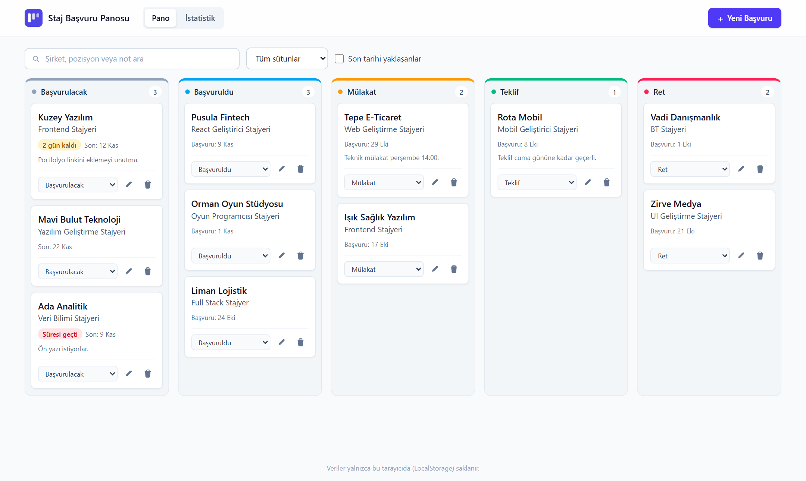
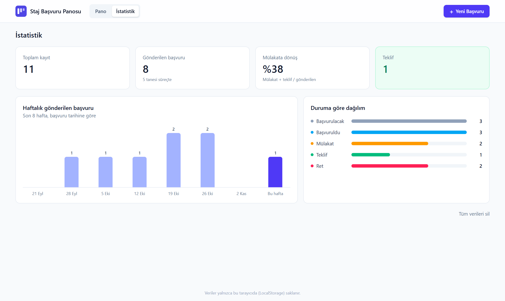
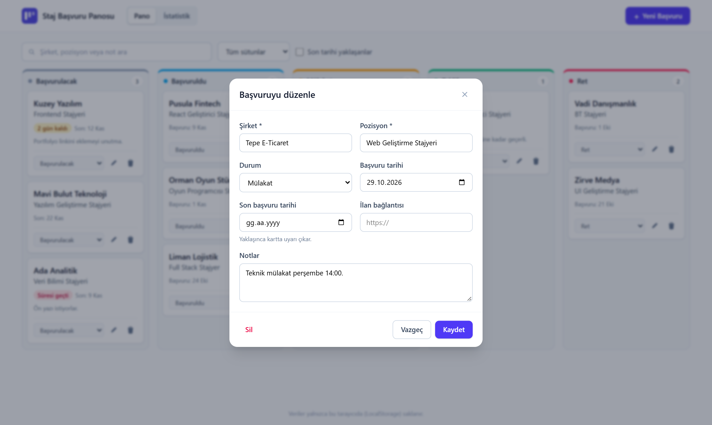
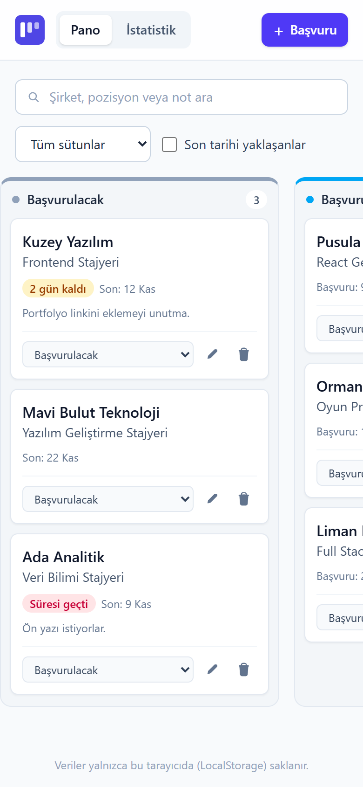

# Staj Başvuru Panosu

Staj ve iş başvurularını tek bir yerden takip etmek için hazırlanmış bir kanban panosu. Her başvuru bir kart olarak "Başvurulacak → Başvuruldu → Mülakat → Teklif / Ret" sütunlarında ilerler. Son başvuru tarihi yaklaşan ilanlar uyarı rozetiyle öne çıkar, istatistik ekranı da başvuru sürecinin genel durumunu gösterir.

Uygulamanın sunucusu yoktur; tüm veriler tarayıcının **LocalStorage** alanında saklanır.

**Canlı demo:** _(Vercel linki buraya eklenecek)_



## Özellikler

- **Kanban pano:** beş durum sütunu ve her sütunda kart sayısı
- **Başvuru ekleme, düzenleme ve silme:** zorunlu alan ve bağlantı doğrulaması olan bir modal form
- **Hızlı durum değiştirme:** karttaki açılır menüyle. "Başvurulacak" sütunundan çıkan bir kartın başvuru tarihi boşsa bugünün tarihi otomatik yazılır.
- **Son tarih uyarısı:** son başvuru tarihine 3 gün veya daha az kalan kartlarda sarı, süresi geçenlerde kırmızı rozet
- **Arama ve filtre:** şirket, pozisyon ve notlarda Türkçe karakter uyumlu arama, tek sütun gösterme, yalnızca son tarihi yaklaşanları listeleme
- **İstatistik ekranı:** toplam kayıt, gönderilen başvuru, mülakata dönüş oranı, teklif sayısı, son 8 haftanın başvuru grafiği ve durum dağılımı
- **Kalıcılık:** veriler sayfa yenilense de korunur, bozuk veri uygulamayı çökertmez
- **Örnek veri:** boş panoda tek tıkla kurgusal başvurular yüklenerek uygulama denenebilir
- **Mobil uyum:** dar ekranda sütunlar yatay kaydırılır

## Ekran görüntüleri

| İstatistik | Düzenleme formu | Mobil |
|---|---|---|
|  |  |  |

## Kullanılan teknolojiler

| Teknoloji | Kullanım amacı |
|---|---|
| [React 19](https://react.dev) | Arayüz bileşenleri, `useReducer` ve Context ile durum yönetimi |
| [Vite 8](https://vite.dev) | Geliştirme sunucusu ve üretim derlemesi |
| [Tailwind CSS 4](https://tailwindcss.com) | Stil (`@tailwindcss/vite` eklentisiyle) |
| LocalStorage | Verilerin tarayıcıda saklanması |
| [Oxlint](https://oxc.rs) | Kod denetimi (lint) |
| [Vercel](https://vercel.com) | Yayınlama |

Ek bir arayüz, grafik veya sürükle-bırak kütüphanesi kullanılmadı. Grafikler saf CSS ile çizildi.

## Kurulum

Gereksinim: [Node.js](https://nodejs.org) 20.19+ veya 22.12+.

```bash
git clone https://github.com/<kullanici-adi>/staj-basvuru-panosu.git
cd staj-basvuru-panosu
npm install
npm run dev
```

Tarayıcıda `http://localhost:5173` adresini aç.

Diğer komutlar:

```bash
npm run build     # dist/ klasörüne üretim derlemesi
npm run preview   # derlenmiş sürümü yerelde çalıştırır
npm run lint      # kod denetimi
```

## Proje yapısı

```
src/
├── components/   Header, Sutun, BasvuruKarti, BasvuruFormu, AramaFiltre, OzetKarti, HaftalikGrafik
├── pages/        PanoSayfasi, IstatistikSayfasi
├── context/      BasvuruContext (reducer + LocalStorage senkronu)
├── utils/        sabitler, tarih, istatistik, depolama, ornekVeri
├── App.jsx
└── main.jsx
```

## Veri modeli

Veriler `staj-panosu` anahtarıyla `{ surum: 1, basvurular: [...] }` biçiminde saklanır. Sürüm alanı, ileride şema değişirse eski verinin dönüştürülebilmesi için tutulur.

```js
{
  id: "uuid",
  sirket: "Kuzey Yazılım",          // zorunlu
  pozisyon: "Frontend Stajyeri",    // zorunlu
  durum: "basvurulacak",            // basvurulacak | basvuruldu | mulakat | teklif | ret
  basvuruTarihi: "2026-11-10",      // veya null
  sonTarih: "2026-11-20",           // veya null
  link: "https://...",
  notlar: "",
  olusturma: "2026-11-10T15:49:26.897Z"
}
```

**Mülakata dönüş oranı** = (Mülakat + Teklif) / gönderilen başvurular. "Başvurulacak" sütunundakiler henüz gönderilmediği için hesaba katılmaz. Veri modeli bir reddin mülakattan önce mi sonra mı geldiğini tutmadığından, "Ret" kartları mülakata dönmemiş sayılır.

## Yapay zekanın kullanımı

Geliştirme boyunca yapay zeka asistanı olarak **Claude** (Anthropic), **Claude Code** masaüstü uygulaması üzerinden kullanıldı. Yapay zekanın kullanıldığı aşamalar:

| Aşama | Yapay zekanın katkısı | Örnek istem |
|---|---|---|
| **Fikir üretme** | Eğitim yönergesi okutularak koşullara uyan proje fikirleri istendi. Önerilen beş fikir arasından bu proje seçildi. | "Bu yönergeye proje fikri öner" |
| **Planlama** | MVP kapsamı (olmazsa olmazlar ve sonraki sürüme kalanlar), veri modeli, bileşen ağacı, klasör yapısı ve adım adım uygulama planı çıkarıldı. | "Staj Başvuru Takip Panosu'nun MVP planını çıkar" |
| **Kurulum** | Vite + React iskeleti ve Tailwind CSS 4 kurulumu yapıldı. Tailwind 4'te `tailwind.config.js` adımının kalktığı yapay zeka tarafından not edildi. | "Projeyi kur" |
| **Bileşen üretimi** | Pano, kart, form, filtre ve istatistik bileşenleri yazıldı. | "Kanban sütunlarını ve başvuru kartını oluştur" |
| **Hata ayıklama ve inceleme** | Tarihlerin UTC'ye çevrilip bir gün kayması, `javascript:` gibi tehlikeli bağlantılar ve bozuk LocalStorage verisi gibi riskler belirlenip kodda önlendi. | "Bu kodda tarih ve güvenlik açısından sorun var mı?" |
| **Test** | Uygulama tarayıcıda açılarak form doğrulaması, ekleme, kalıcılık, durum değiştirme, Türkçe arama, filtreler, silme ve istatistik hesapları tek tek denendi. | "Uygulamayı çalıştırıp tüm akışları test et" |
| **Stil önerisi** | Dar sütunlarda yazıların kesilmesi fark edildi; kart üzerindeki "Düzenle / Sil" yazıları simge düğmelere çevrildi. | — |
| **Dokümantasyon** | Ekran görüntüleri alındı ve bu README'nin taslağı hazırlandı. | "README'yi teslim yönergesine göre hazırla" |

**Yapay zekanın çıktısını nasıl doğruladım:** Üretilen kod çalıştırılarak denendi. İstatistik ekranındaki sayılar örnek veriler üzerinde elle sayımla karşılaştırıldı (örneğin 8 gönderilen başvurudan 3'ü mülakat veya teklif aşamasında, oran %38). Derleme (`npm run build`) ve lint (`npm run lint`) hatasız tamamlandı.

## Sonraki sürüm için fikirler

- Kartları sütunlar arasında sürükle-bırak ile taşıma
- Verileri JSON olarak dışa ve içe aktarma (yedekleme)
- Karanlık mod
- Mülakat tarihi alanı ve takvim görünümü
